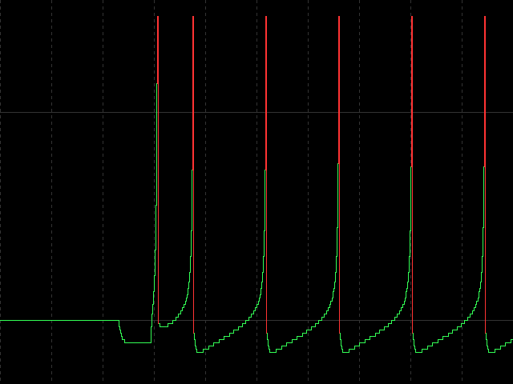
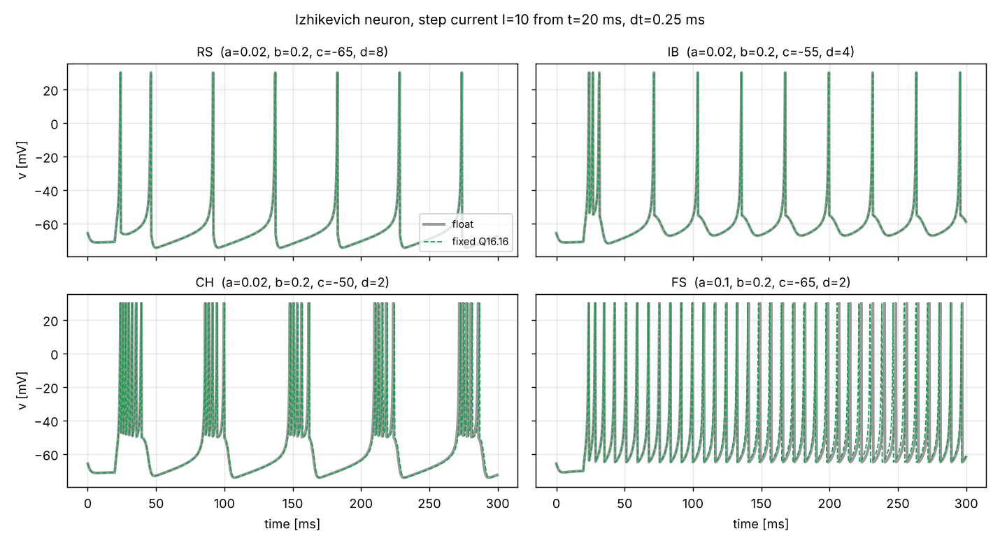

# spiking-neuron-proto

Basys3 (Artix-7 XC7A35T) 上で **単一ニューロンのスパイクを実時間シミュレーション**し、
膜電位を **VGA（オシロ風）・UART（PC でグラフ）・7セグ・LED** に出すプロトタイプ。

> 位置づけ: 期限つきで「まず動くもの」を作るためのプロトタイプ。
> 学習用にゼロから作り直す `../spiking-neuron/` とは独立（そちらには触れていない）。


*シミュレーションで出力した VGA 1 フレーム（RS ニューロン、I=10。発火間隔が徐々に広がる＝適応）*

## できること

| 項目 | 内容 |
|---|---|
| モデル | Izhikevich（RS / IB / CH / FS をスイッチで切替）と LIF |
| 数値 | Q16.16 固定小数点、前進 Euler、dt = 0.25 ms（実時間 4 kHz） |
| 入力 | スライドスイッチで電流 I を設定 |
| 出力 | VGA 640x480 波形、UART 921600 baud、7セグ（発火率 Hz）、LED（発火） |
| 検証 | Python 固定小数点モデルと RTL が **ビット単位で一致**（10 ケース）、UART 全フレーム一致 |


*Izhikevich 4 タイプ。灰=浮動小数点、緑破線=固定小数点（Q16.16）。重なっている*

## 操作（Basys3）

| スイッチ | 機能 |
|---|---|
| `sw[7:0]` | 入力電流 I = sw × 0.25（**40 で I=10**。Izhikevich はこのあたりから発火） |
| `sw[9:8]` | プリセット 0=RS 1=IB 2=CH 3=FS |
| `sw[11:10]` | VGA の時間軸 0:×1 (160 ms) 1:×2 (320 ms) 2:×4 (640 ms) 3:×8 (1.28 s) |
| `sw[15]` | 0: Izhikevich / 1: LIF（LIF は I > 15、つまり sw > 60 で発火） |
| `btnC` | リセット |
| LED | `led[0]` 発火（約 40 ms に引き伸ばし）、`led[1]` mode、`led[3:2]` preset |
| 7セグ | 直近 1 秒の発火数 [Hz] |

## ディレクトリ

```
spiking-neuron-proto/
├── rtl/                  SystemVerilog（Vivado で合成。iverilog -g2012 でもシミュレーション可）
│   ├── top_basys3.sv       トップ（配線とスイッチ処理）
│   ├── neuron_core.sv      ニューロン本体（FSM。乗算は serial_mul を共有）
│   ├── serial_mul.sv       符号付き直列乗算器 (DSP 不使用 → 100MHz で余裕)
│   ├── preset_rom.sv       Izhikevich の (a,b,c,d)
│   ├── tick_gen.sv         4 kHz のステップ信号
│   ├── uart_tx.sv / uart_frame_tx.sv   UART と 4byte フレーム
│   ├── vga_timing.sv       640x480@60Hz（クロックイネーブル方式）
│   ├── wave_display.sv     リングバッファ + 波形描画
│   └── bin2bcd.sv / seg7_4digit.sv     発火率の 7セグ表示
├── sim/                  テストベンチ（tb_neuron_core / tb_top / tb_bin2bcd）
├── python/
│   ├── ref_model.py        浮動小数点 / 固定小数点の参照モデル（RTL とビット一致）
│   ├── run_tests.py        RTL を回して参照モデルと照合
│   ├── serial_viewer.py    UART 受信 → リアルタイム描画
│   └── make_figures.py     docs/ の図を作る
├── constraints/basys3.xdc  ピン割り当て
├── build.tcl / build.bat / program.tcl / program.bat   Vivado バッチビルド（pingpong-2D と同じ流儀）
└── docs/
```

## 使い方

### 1. シミュレーション（Mac。要 Icarus Verilog: `brew install icarus-verilog`）

```sh
make test        # core / bcd / top の全部。top は約 35 秒
make figures     # docs/ の図を作り直す
```

### 2. 実機

1. `build.bat`（`VIVADO_DIR` は自分の環境に合わせる）→ `out/top_basys3.bit`
   **ビルド後、ログ末尾の `WNS` が 0 以上か確認**（`out/timing.rpt`）。
2. `program.bat` で書き込み。VGA ケーブルをモニタへ。
3. PC で波形を見る（USB は書き込みに使っているケーブルと同じ）:
   ```sh
   pip install pyserial matplotlib
   python3 python/serial_viewer.py --port /dev/tty.usbserial-XXXX   # ls /dev/tty.usb* で確認
   ```
   録画の再生: `python3 python/serial_viewer.py --replay sim/out/uart_capture.bin --save out.png`

### 実機での確認チェックリスト（上から順に）

1. 書き込み後、`sw[7:0]=0` → 7セグ `0`、VGA に平らな線（-65 mV の高さ、ほぼ画面の下 5/6）
2. `sw[7:0]=40`（下から 3 番目と 5 番目だけ ON）→ `led[0]` が時々光り、VGA に発火が出て 7セグ ≈ 数 Hz〜20 Hz
3. `sw[9:8]` を変える → 発火パターンが変わる（RS→IB→CH→FS。FS は 7セグ ≈ 100 Hz 前後）
4. `sw[11:10]` を変える → 時間軸が伸び縮み
5. `serial_viewer.py` で波形が出る。`dropped frames` が 0 のまま
6. `sw[15]=1`, `sw[7:0]=80` → LIF（約 45 Hz 前後で発火）

## 検証の状況（正直に）

| 項目 | 状態 |
|---|---|
| RTL ⇔ Python 固定小数点モデル（Izhikevich 4 種・大電流・負電流・LIF、各 1200 ステップ） | **ビット一致 PASS**。参照モデルの定数を 1 変えると FAIL になることも確認 |
| UART 1327 フレーム（トップから復号）⇔ 参照モデル | 全フレーム一致、シーケンス番号連続 |
| 7セグ発火率 ⇔ 参照モデル | 一致 |
| VGA | シミュレーションで 1 フレーム描画して目視確認（`docs/vga_frame_sim.png`） |
| **Vivado 合成・配置配線・タイミング** | **未実施**（この環境に Vivado がない）。`build.bat` 後に WNS / `util.rpt` / `drc.rpt` を確認すること |
| **実機（VGA モニタ・UART）** | **未実施** |

実機で詰まりそうな点:
- シミュレーションは `TICK_DIV=5000` に縮めて走らせている（実機は 25000 = 実時間）。UART は 1 フレーム ≈ 4360 クロックで、25000 クロックごとのステップに十分収まる。
- VGA は 100 MHz ÷ 4 のイネーブルで 25 MHz 相当。ほとんどのモニタは映るが、画面サイズ表示が `640x480 @60Hz` 近傍にならない場合は教えてほしい（25.175 MHz との差は 0.7%）。
- Mac の USB シリアル名は環境で違う。`ls /dev/tty.usbserial-*`。
- Izhikevich は I が大きすぎると（sw = 255, I ≈ 64）FS で 1 ステップ内に電位が大きく跳ぶ。固定小数点の範囲内（±32768 mV 相当）では問題ないことを確認済み。

## 設計メモ

- **単一クロック + クロックイネーブル**。分周カウンタの出力をクロックにしない（VGA の 25 MHz も、ニューロンの 4 kHz も enable）。
- **乗算は直列 (shift-add)**。ステップが 0.25 ms (=25000 クロック) に 1 回なので、1 ステップ ≈ 140 クロックで足りる。DSP を使わずタイミングに悩まない。ニューロン数を増やすときに DSP 版（またはパイプライン乗算器）に差し替える。
- **更新順序**: `v` と `u` はどちらも旧値から微分を計算してから同時に更新（`neuron_core.sv` の S_NXT/S_UPD）。
- **VGA 波形**: BRAM 的な 1024 エントリのリングバッファ。表示は最新 640 サンプルで、フレーム先頭で書き込み位置を保存するため、走査中にサンプルが追加されても画面が崩れない。各列は前の列との間を縦に塗るので急峻な発火も途切れない。
- **UART フレーム**（4 byte, リトルエンディアン）: `0xA5` / `v[7:0]` / `v[15:8]` / `{seq[3:0], preset[1:0], mode, spike}`。`v` は Q8.8 の int16（mV = v/256）。データ中に `0xA5` が現れても、次フレーム頭の `0xA5` を確認してから採用する。

## 今は入っていないもの

Hodgkin-Huxley、UART 受信（PC から I(t) を送る）、複数ニューロン（時分割ネットワーク）、`u` の重ね描き。
